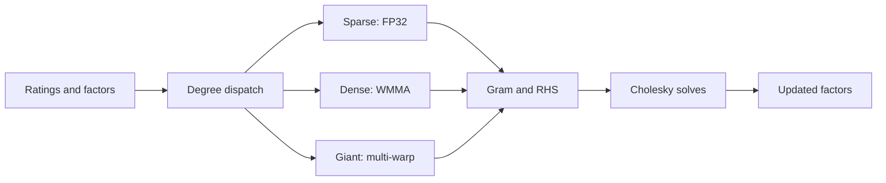

# APR BALS

APR-BALS implements explicit-feedback ALS on GPUs using density-adaptive tensor-core dispatch. This repository contains the implementation, baseline comparisons, and experimental evidence for the accompanying research.

Research topic: **Density-Adaptive Tensor-Core Dispatch for ALS Matrix Factorization on GPUs**.

[Verified results](#verified-results) · [Evidence index](part2/new_results/README.md) · [Reproduction guide](docs/reproduction.md) · [Historical experiments](results/README.md)

## Method overview

ALS alternates between updating user and item factors from observed ratings.
APR routes entities by training degree: sparse entities use scalar arithmetic,
dense entities use tensor-core Gram assembly, and giant entities distribute
their work across cooperating warps. Cholesky solves produce the updated factors.
The October implementation retains contiguous prefixes from the original ordering;
validation removal can disturb degree order, as recorded in the
[dispatch audit](part2/new_results/dispatch_audit.json).



The implementations answer different experimental questions:

| Component | Role |
|---|---|
| [APR](justapr.cu) | Standalone dispatch implementation with recipe-dependent solver and momentum options. |
| [Shared-binary control](main_experiment.cu) | Historical scalar FP32 and APR legs in one process, with the same solver policy. |
| [October controls](part2/new_results/src/) | Separate precision/dataflow experiments, including a same-dataflow FP32 control. |
| [Local BALS](only_scalar_fp32.cu) and cuMF ports | Standalone comparison implementations; provenance and instrumentation differ. |

The shared-binary FP32 leg, October same-dataflow control, and external BALS
reimplementation are separate baselines. Their speedups are not interchangeable.

## Verified results

The October comparisons below use single recorded runs on an RTX 3060.
They measure wall time to a common warm-validation target for each dataset.
Evaluation is included in the timed training loop; loading and preparation are excluded.

<!-- evidence:headlines:start -->
| Comparison | Protocol and ranks | Result | Evidence |
|---|---|---|---|
| APR vs cuMF_als | October warm-validation time to target; 20 documented K/F pairings | **2.6–5.2×** | [Rows and calculation](docs/evidence.md#external-time-to-target) |
| APR vs cuMF_CCD | October warm-validation time to target; 20 matched-rank comparisons | **3.3–6.9×** | [Rows and calculation](docs/evidence.md#external-time-to-target) |
| Final warm-validation RMSE | APR K=96; ALS F=100; CCD K=96 | Absolute relative difference **<0.1% vs ALS**, **<0.2% vs CCD** | [Exact RMSEs and denominators](docs/evidence.md#final-validation-accuracy) |
<!-- evidence:headlines:end -->

Speedup means baseline time divided by APR time at the same dataset target.
The accuracy bounds use each baseline's final RMSE as the denominator.
They apply only to the stated final-rank comparison.

APR has slightly higher final RMSE than CCD on ML-10M and lower final RMSE
on the other datasets. Target-crossing speed and final accuracy answer different questions.
The [evidence guide](docs/evidence.md#final-validation-accuracy) gives the direction,
unrounded values, calculations, and commit-pinned links that highlight source rows.

These external measurements have no new repeat-run variance estimate.
Shared-host contention and differences in evaluation overhead limit timing interpretation.
No statistical significance or sub-percent timing reliability is established.

### Historical baseline and T4 findings

The original paired-harness experiments use the original 80/20 train/test split.
The August archive contains repeated measurements against the shared-binary FP32 leg;
the T4 archive provides separate cross-device evidence under that historical protocol.
Neither is an October external-baseline experiment.

| Historical experiment | Result under the original protocol | Evidence |
|---|---|---|
| August RTX 3060 paired harness | 100 runs across 20 configurations; maximum relative wall-speedup standard deviation 0.44% | [Archived summary](https://github.com/hafizr283/apr-bals/blob/437e10e55c066e50c6077043313eec2fdaf46247/results/PAPER_MEASUREMENTS_20260803/variance_5x_summary.txt?plain=1#L29-L30) |
| T4, Netflix K96 | 10.78× wall speedup over the shared-binary FP32 leg; FP32 solvers, original stopping rule | [Raw wall times](https://github.com/hafizr283/apr-bals/blob/437e10e55c066e50c6077043313eec2fdaf46247/results/t4_latest_res_22_7_2026/T4_MAIN_WL_20260721_210336/netflix_k96.txt?plain=1#L42-L60) |

See [historical evidence and its scope](docs/evidence.md#historical-evidence)
for the retained results, source logs, solver settings, and repetition counts.
Historical variability must not be attached to the October single runs.

## Understanding the evidence

There are two principal evaluation protocols:

- **Original 80/20:** the preprocessor creates a frozen train/test split.
  Historical comparisons, momentum diagnostics, and several numerical controls use it.
- **October external 70/10/20:** validation is carved from the original training data,
  leaving the original test ratings intact. External curves evaluate a shared
  warm-validation mask that excludes ratings involving unseen training entities.

The original test was used in historical tuning. Creating a later validation split
does not erase that exposure. The evidence guide describes this limitation and
identifies the protocol for each experiment family.

| Quantity | Meaning |
|---|---|
| Test RMSE | Error on the designated test ratings; report the split and cold-entity policy. |
| Warm-validation RMSE | Error on the shared validation subset with both entities observed in training. |
| Time to target | Cumulative training-loop wall time at the first recorded target crossing. |
| Per-sweep time | Cost of an iteration; it does not measure time to a common accuracy. |
| Wall time to convergence | Time until the configured stopping rule; the rule and checking interval matter. |

The external CSV has **84 records**, with **84 available raw trajectory logs**.
Momentum has **twenty complete pairs**. The restored four-way and cumulative tables
contain all 80 and six planned records, respectively.
The [coverage table](docs/evidence.md#coverage) separates available records from
planned runs and distinguishes numerical replay from inventory-only checks.

The October source/evidence copy has been restored from the full archive.
Recorded coverage does not establish that every possible experiment or reproduction is complete.

## Check the archived results

From the repository root, with Python 3.9 or newer:

```bash
python scripts/verify_paper_evidence.py --check
```

This CPU-only check uses the Python standard library and the
[curated manifest](docs/evidence_manifest.json). It recomputes the reported external
ratios, accuracy differences, CCD selections, and available momentum crossings.
It also checks declared coverage, available run summaries, fingerprints, and links.

Expected outcome: explicit `WARNING:` lines for scope limitations, then
`PASS: archived evidence consistent; ...`. A successful check confirms consistency
of the archived evidence within the documented coverage.

Unexpected missing sources, duplicate keys, numerical mismatches, invalid references,
or documentation drift produce a nonzero exit. The check requires no CUDA installation,
does not train models, and does not modify result files.

## Reproduce experiments

Training requires Linux, an NVIDIA GPU, a compatible CUDA toolkit, a C++ compiler,
and the appropriate prepared datasets. Some preparation and analysis scripts also
require NumPy and SciPy. These dependencies are unnecessary for the archive check.

The [reproduction guide](docs/reproduction.md) separates historical commands,
October commands, build flags, required inputs, expected outputs, and execution gaps.
Its hardware table records campaign-specific GPU, driver, and CUDA information.

The existing runners include machine-specific paths, dependencies on prebuilt
binaries and completion-marker waits. Preparation helpers and the target manifest
are now restored; their original path/import assumptions still require adaptation.
Some runners overwrite evidence or modify experimental source files.
They are not a validated one-command reproduction package.

Inspecting archived evidence and rerunning GPU training are separate operations.
Full reproduction from datasets and a clean build has not been validated here.
The [large-artifact guide](docs/artifacts.md) provides the external ZIP link, checksum,
excluded-file inventory and recommended journal archive arrangement.

## Repository layout

```text
justapr.cu / justapr_2gpu.cu      APR implementations
main_experiment.cu               Shared-binary FP32/APR comparison
only_scalar_fp32.cu              Local BALS reimplementation
*.cuh                           Shared dispatch, Gram, solver, and data code
cumf_als-master/                 Modified external ALS implementation
cumf_ccd-master/                 Modified external CCD implementation
cumf_sgd-master/                 Modified external SGD implementation
part2/new_results/               October evidence, source snapshots, and runners
results/                        Historical experiments and retention index
docs/                           Evidence manifest and detailed guides
scripts/                        Read-only evidence verification
```

Use [the October index](part2/new_results/README.md) for current external comparisons.
Use [the historical index](results/README.md) for earlier protocols and controls.
Original result filenames and directories are retained for stable references.

## Limitations and baseline provenance

The documented APR ranks and ALS rank pairings are listed in the
[external protocol](docs/evidence.md#protocols); rank mismatches remain explicit.
GPU coverage is limited to the recorded campaigns. Historical T4 measurements
do not establish October external speedups on T4 or support arbitrary GPUs and ranks.

Warm-validation masking excludes cold-start cases from the headline comparisons.
The original ordering can route some entities differently from a fresh degree sort.
Replay scope, single-run timing, and the original test's historical exposure
limit the conclusions that can be drawn from this archive.

cuMF_als is a guarded CUDA port, cuMF_CCD has local timing and reduction changes,
and cuMF_SGD has per-epoch evaluation and synchronization instrumentation.
The BALS comparison is a local reimplementation, not an independently released
BALS executable. See the [baseline provenance](docs/reproduction.md#baseline-provenance)
and the [external evaluation protocol](docs/reproduction.md#external-evaluation-protocol).

Existing upstream attribution and third-party license files remain with the vendored
implementations. Scientific protocols and interpretation are consolidated in the
evidence and reproduction guides, with direct links to the archived measurements.
